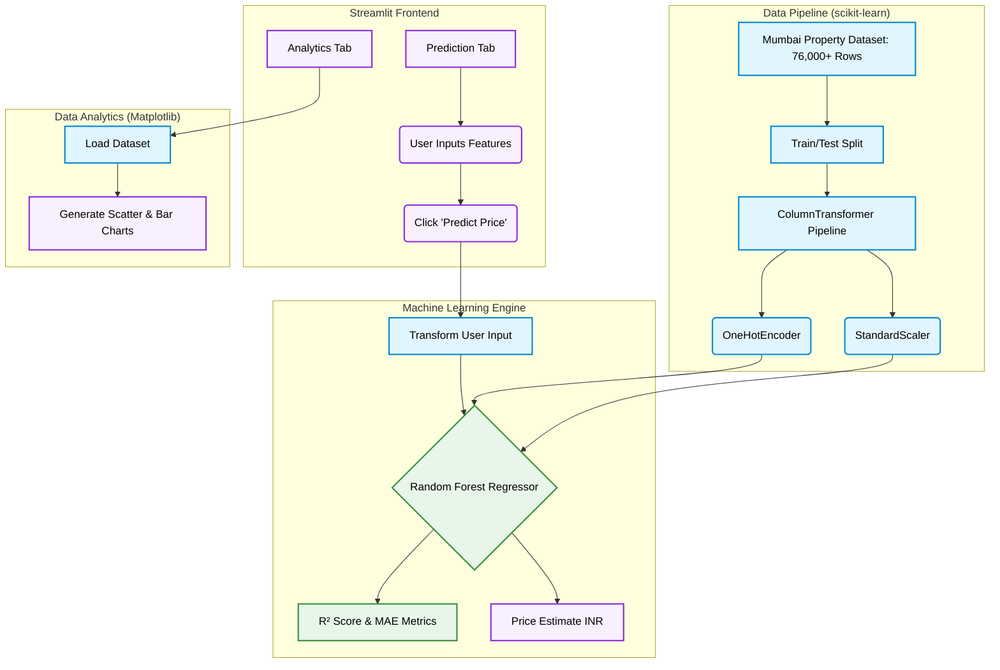

# House Price Predictor (Random Forest)

An end-to-end Machine Learning pipeline that predicts Mumbai house prices using a Random Forest Regressor, built with Streamlit and scikit-learn.

> **Live Deployments:**
> * **Interactive Streamlit App:** [nielit-project.streamlit.app](https://nielit-project.streamlit.app/)

---

## Overview

House Price Predictor is a machine learning solution that models real estate property values across the Mumbai metropolitan area. The system pairs an ensemble Random Forest regressor with an interactive Streamlit web dashboard and an offline Tkinter desktop interface. It incorporates a persistent SQLite transaction log for past predictions and provides exploratory data visualizations using Matplotlib and Seaborn to illuminate price determinants across localities.

---

## Architecture Overview



---

## Features

| Feature | Description |
| ------- | ----------- |
| **Interactive Interfaces** | Streamlit web application and standalone Tkinter desktop GUI |
| **Ensemble ML Pipeline** | Scikit-learn Random Forest Regressor with comparative Linear Regression baselines |
| **Data Transformation** | Unified `ColumnTransformer` handling numerical scaling (`StandardScaler`) and categorical encoding (`OneHotEncoder`) |
| **Audit Logging** | SQLite database (`predictions.db`) persistently storing timestamped user valuation queries |
| **Market Analytics** | Interactive Matplotlib and Seaborn exploratory visualizations for neighborhood pricing trends |

---

## Technology Stack

| Component | Technology |
| --------- | ---------- |
| Application Frameworks | Streamlit, Tkinter |
| Machine Learning | Scikit-Learn (RandomForestRegressor, LinearRegression) |
| Data Processing | Pandas, NumPy |
| Visualizations | Matplotlib, Seaborn |
| Database | SQLite |
| Testing & Linting | pytest, ruff |
| Containerization | Docker |

---

## Project Structure

```
NIELIT-Project/
├── main.py                     # Streamlit web application and tab views
├── tkinter_app.py              # Desktop Tkinter GUI client
├── ml.py                       # Data pipeline, model training, and evaluation
├── db.py                       # SQLite database logging operations
├── Mumbai House Prices.csv     # Historical housing sales dataset (76,000+ records)
├── tests/
│   ├── conftest.py
│   └── test_app.py             # Unit tests for prediction and pipeline logic
├── Dockerfile                  # Container definition
├── requirements.txt            # Python dependencies
└── README.md
```

---

## Setup and Installation

### Prerequisites

- Python 3.10+

### 1. Clone the repository

```bash
git clone https://github.com/Shashank17singh/NIELIT-Project.git
cd NIELIT-Project
```

### 2. Install dependencies

```bash
pip install -r requirements.txt
```

### 3. Run the application

To launch the web interface:

```bash
streamlit run main.py
```

To launch the desktop GUI:

```bash
python tkinter_app.py
```

---

## Running the Tests

Execute automated tests using pytest:

```bash
pytest tests/
```

Run static code analysis and linting:

```bash
ruff check .
```

---

## Deployment

The application is containerized and deployable to standard container hosts:

```bash
docker build -t nielit-house-predictor .
docker run -p 8501:8501 nielit-house-predictor
```

Live deployment is hosted on Streamlit Community Cloud at [nielit-project.streamlit.app](https://nielit-project.streamlit.app/).

---

## Known Limitations

- Model inference is calibrated for Mumbai residential real estate transactions and requires retraining for non-Mumbai geographical regions.
- Outlier filtering removes irregular configurations (e.g. extreme BHK counts with low square footage).

---

## License

This project is licensed under the MIT License. See [LICENSE](LICENSE) for details.
